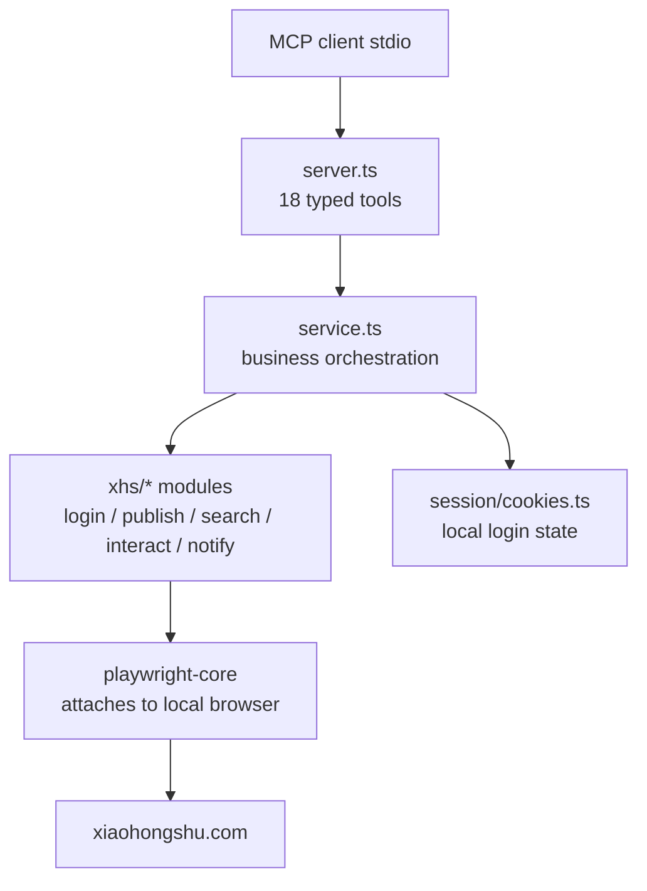

<div align="center">

# 🍠 Xiaohongshu MCP

**A stdio MCP server that lets AI agents operate Xiaohongshu (RED / Little Red Book) through your local browser — login, publish, search, read, interact, and handle notifications.**

Reuses the browser already installed on your machine (no browser download), keeps login state locally, and turns Xiaohongshu into 18 structured MCP tools.

[](LICENSE)
[](https://nodejs.org/)
[](https://www.typescriptlang.org/)
[](https://modelcontextprotocol.io/)
[](#requirements)

[English](README.md) · [简体中文](README_zh-CN.md)

</div>

---

## Why this project?

Most "Xiaohongshu automation" projects are either fragile one-off scripts or heavy Selenium bots that download their own browser. This server takes a cleaner approach:

- **Reuses your local browser** via `playwright-core` — no Chromium download, no extra gigabytes, and your existing browser profile/extensions are available.
- **Persistent login state** — scan the QR code once; cookies and the browser data directory are saved locally. Switch accounts with one tool call.
- **Risk-aware** — when Xiaohongshu's anti-bot layer intercepts a request, the tool returns a clear "blocked by site security policy, try another network" message instead of a cryptic timeout.
- **18 typed tools** covering login, publishing (image + video), reading (feed / search / detail / profile), interaction (comment / like / favorite), and notifications.

> This project is for personal automation and research. Respect Xiaohongshu's terms of service and rate limits; do not use it for spam, scraping at scale, or account abuse.

---

## Requirements

| Requirement | Detail |
|---|---|
| Node.js | 18+ |
| A local browser | Chrome / Edge / Chromium (playwright-core attaches to the system browser) |
| OS | Windows / macOS / Linux (wherever a supported browser runs) |
| Dependencies | `@modelcontextprotocol/sdk`, `playwright-core`, `zod` |

## Quick start

```powershell
# 1. Install dependencies
npm install

# 2. Build TypeScript
npm run build

# 3. (Optional) run a smoke test against the tool surface
npm run smoke

# 4. Start the stdio server (usually done by your MCP client)
node dist/index.js
```

There is also a `doctor` entry (`node dist/doctor.js`) for environment diagnostics, and a cross-platform packager (`npm run pack`) that produces a ready-to-run distribution under `release/`.

---

## MCP client configuration

Point your MCP client at the compiled entry:

```json
{
  "mcpServers": {
    "xiaohongshu": {
      "command": "node",
      "args": ["C:\\absolute\\path\\to\\xiaohongshu-mcp\\dist\\index.js"]
    }
  }
}
```

On macOS / Linux use the corresponding absolute path. If `node` is not on `PATH`, use the full path to your Node executable.

### Typical agent flow

1. `check_login_status` — see whether a session already exists.
2. `get_login_qrcode` — open a browser window and scan with the Xiaohongshu app (the call waits until login succeeds or times out).
3. Use the read / publish / interact / notify tools.
4. To switch accounts: `delete_cookies`, then `get_login_qrcode` again.

---

## Tools (18)

### Login & session (3)

| Tool | Purpose |
|---|---|
| `check_login_status` | Check whether the current session is logged in |
| `get_login_qrcode` | Open a browser and wait for QR-code scan; supports headless mode and timeout |
| `delete_cookies` | Reset login state (cookies + browser data dir) for re-login or account switch |

### Publishing (2)

| Tool | Purpose |
|---|---|
| `publish_content` | Publish an image note: title, body, images (local path or URL), tags, schedule, original declaration, visibility, products |
| `publish_with_video` | Publish a video note: title, body, local video file, tags, schedule, visibility, products |

### Reading (5)

| Tool | Purpose |
|---|---|
| `list_feeds` | Get the home feed list |
| `search_feeds` | Search notes with filters (sort, type, time, scope, location) |
| `get_feed_detail` | Note detail: content, images, author, engagement stats, comments; video notes include signed video streams and subtitles |
| `user_profile` | Any user's profile + notes/favorites/likes tab |
| `get_my_profile` | Current logged-in user's profile + tabs |

### Interaction (4)

| Tool | Purpose |
|---|---|
| `post_comment_to_feed` | Comment on a note |
| `reply_comment_in_feed` | Reply to a specific comment (by comment_id or user_id) |
| `like_feed` | Like / unlike a note (idempotent) |
| `favorite_feed` | Favorite / unfavorite a note (idempotent) |

### Notifications (4)

| Tool | Purpose |
|---|---|
| `get_unread_count` | Unread counts for mentions / likes / connections (does not clear markers) |
| `list_notifications` | Notification list with original-note refs (clears the unread marker) |
| `reply_notification` | Reply to a comment directly from notifications |
| `like_notification` | Like / unlike a comment from notifications |

---

## Companion agent skills

The `skills/` directory ships 8 reusable Agent Skills that wrap common workflows on top of the MCP tools:

| Skill | Purpose |
|---|---|
| `xhs-login-skill` | Login / account switching workflow |
| `setup-xhs-mcp-skill` | Environment setup and MCP client configuration |
| `post-to-xhs-skill` | End-to-end note publishing with pre-publish confirmation |
| `xhs-content-plan-skill` | Content planning helpers |
| `xhs-explore-skill` | Feed exploration and discovery |
| `xhs-search-skill` | Structured search with filters |
| `xhs-interact-skill` | Comment / like / favorite workflows |
| `xhs-profile-skill` | Profile reading and analysis |

Each skill is a self-contained `SKILL.md` — load the ones your agent needs.

---

## How it works



- **stdio transport** — pure JSON-RPC over stdin/stdout; logs go to stderr.
- **Local browser reuse** — `playwright-core` does not download a browser; it launches the system Chrome/Edge.
- **Risk handling** — anti-bot interception is detected and surfaced as a readable `isError` result rather than crashing the call.

---

## Security & privacy

- Login state (cookies, browser data directory) is stored **locally on your machine** — never uploaded.
- `cookies.json` and `*.local.json` are git-ignored by default.
- `delete_cookies` cleans both the cookie file and the browser data directory so no account info lingers.
- Never commit `cookies.json`, browser profiles, or screenshots containing QR codes / personal data.

---

## Troubleshooting

| Problem | Check / fix |
|---|---|
| `playwright-core` cannot find a browser | Install Chrome/Edge, or set the browser path in the launcher config |
| Login QR code window doesn't appear | Run in headed mode (default); use `headless=true` only on servers and scan the returned base64 image |
| Tools return "blocked by site security policy" | This is Xiaohongshu's anti-bot layer — switch network / wait / complete any verification in the opened browser |
| `dist/index.js` not found | Run `npm run build` first |
| Want a portable distribution | Run `npm run pack` (or `npm run pack:slim`) to produce `release/` |

---

## Project structure

```
xiaohongshu-mcp/
├── src/
│   ├── index.ts            # stdio entry
│   ├── mcp/server.ts       # 18 tool registrations
│   ├── service.ts          # business orchestration
│   ├── browser/            # local browser launch & fingerprint
│   ├── humanize/           # typing / delay / profile
│   ├── session/            # cookies & login sessions
│   ├── xhs/                # per-feature modules (login, publish, search, ...)
│   └── util/
├── skills/                 # 8 companion Agent Skills
├── scripts/
│   ├── pack.mjs            # cross-platform distribution packager
│   └── smoke.mjs           # smoke test
├── package.json
├── tsconfig.json
└── README.md
```

## License

[Apache-2.0](LICENSE)
