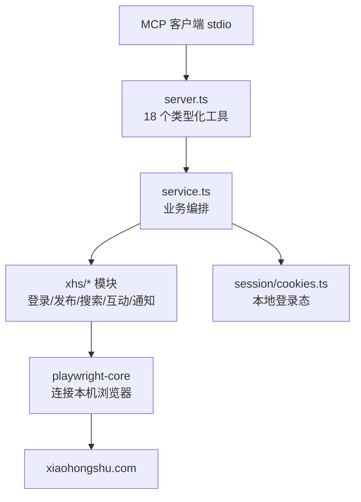

<div align="center">

# 🍠 小红书 MCP

**一个 stdio MCP 服务器，让 AI Agent 通过你本机的浏览器操作小红书 —— 登录、发布、搜索、阅读、互动、处理通知。**

复用本机已安装的浏览器（不下载浏览器），本地保存登录态，把小红书变成 18 个结构化的 MCP 工具。

[](LICENSE)
[](https://nodejs.org/)
[](https://www.typescriptlang.org/)
[](https://modelcontextprotocol.io/)
[](#环境要求)

[English](README.md) · [简体中文](README_zh-CN.md)

</div>

---

## 为什么需要这个项目？

大多数"小红书自动化"项目要么是脆弱的一次性脚本，要么是笨重的 Selenium 机器人（还要自己下载浏览器）。本服务器走了一条更干净的路：

- **复用本机浏览器**：通过 `playwright-core` 连接系统已安装的 Chrome/Edge，不下载 Chromium，不占额外空间，你已有的浏览器配置和扩展都能用。
- **持久化登录态**：扫一次二维码，cookies 和浏览器数据目录保存在本地；切换账号只需一个工具调用。
- **风控感知**：被小红书反爬拦截时，工具会返回清晰的"被站点安全策略拦截，请换网络环境"提示，而不是一句难懂的超时。
- **18 个类型化工具**：覆盖登录、发布（图文/视频）、读取（首页/搜索/详情/主页）、互动（评论/点赞/收藏）、通知。

> 本项目用于个人自动化与研究。请遵守小红书的服务条款和频率限制，不要用于垃圾内容、大规模抓取或账号滥用。

---

## 环境要求

| 要求 | 说明 |
|---|---|
| Node.js | 18+ |
| 本机浏览器 | Chrome / Edge / Chromium（playwright-core 连接系统浏览器） |
| 操作系统 | Windows / macOS / Linux（只要能运行受支持的浏览器） |
| 依赖 | `@modelcontextprotocol/sdk`、`playwright-core`、`zod` |

## 快速开始

```powershell
# 1. 安装依赖
npm install

# 2. 编译 TypeScript
npm run build

# 3.（可选）对工具面做冒烟测试
npm run smoke

# 4. 启动 stdio 服务器（通常由 MCP 客户端自动启动）
node dist/index.js
```

另有环境诊断入口 `node dist/doctor.js`，以及跨平台打包器 `npm run pack`（在 `release/` 下生成可直接运行的分发包）。

---

## MCP 客户端配置

把 MCP 客户端指向编译后的入口：

```json
{
  "mcpServers": {
    "xiaohongshu": {
      "command": "node",
      "args": ["C:\\absolute\\path\\to\\xiaohongshu-mcp\\dist\\index.js"]
    }
  }
}
```

macOS / Linux 使用对应的绝对路径。如果 `node` 不在 `PATH`，请填写 Node 可执行文件的完整路径。

### Agent 典型流程

1. `check_login_status` —— 检查是否已有登录态。
2. `get_login_qrcode` —— 打开浏览器窗口，用小红书 App 扫码（调用会一直等到登录成功或超时）。
3. 使用读取 / 发布 / 互动 / 通知类工具。
4. 切换账号：先 `delete_cookies`，再 `get_login_qrcode` 扫新账号。

---

## 工具列表（18 个）

### 登录与会话（3 个）

| 工具 | 用途 |
|---|---|
| `check_login_status` | 检查当前会话是否已登录 |
| `get_login_qrcode` | 打开浏览器等待扫码；支持无头模式与超时 |
| `delete_cookies` | 重置登录态（cookies + 浏览器数据目录），用于重新登录或切换账号 |

### 发布（2 个）

| 工具 | 用途 |
|---|---|
| `publish_content` | 发布图文笔记：标题、正文、图片（本地路径或 URL）、标签、定时、原创声明、可见范围、商品 |
| `publish_with_video` | 发布视频笔记：标题、正文、本地视频文件、标签、定时、可见范围、商品 |

### 读取（5 个）

| 工具 | 用途 |
|---|---|
| `list_feeds` | 获取首页推荐列表 |
| `search_feeds` | 搜索笔记，支持排序/类型/时间/范围/位置筛选 |
| `get_feed_detail` | 笔记详情：内容、图片、作者、互动数据、评论；视频笔记含带签名的视频流与字幕 |
| `user_profile` | 任意用户主页 + 笔记/收藏/点赞 tab |
| `get_my_profile` | 当前登录用户主页 + 各 tab |

### 互动（4 个）

| 工具 | 用途 |
|---|---|
| `post_comment_to_feed` | 给笔记发表评论 |
| `reply_comment_in_feed` | 回复指定评论（按 comment_id 或 user_id） |
| `like_feed` | 点赞 / 取消点赞（幂等） |
| `favorite_feed` | 收藏 / 取消收藏（幂等） |

### 通知（4 个）

| 工具 | 用途 |
|---|---|
| `get_unread_count` | 评论@ / 赞藏 / 新增关注的未读数（不清除标记） |
| `list_notifications` | 通知列表，附带原笔记引用（会清除未读标记） |
| `reply_notification` | 直接从通知回复评论 |
| `like_notification` | 从通知给评论点赞 / 取消点赞 |

---

## 配套 Agent Skill

`skills/` 目录附带 8 个可复用的 Agent Skill，在 MCP 工具之上封装常见工作流：

| Skill | 用途 |
|---|---|
| `xhs-login-skill` | 登录 / 切换账号流程 |
| `setup-xhs-mcp-skill` | 环境搭建与 MCP 客户端配置 |
| `post-to-xhs-skill` | 端到端笔记发布（含发布前确认） |
| `xhs-content-plan-skill` | 内容规划辅助 |
| `xhs-explore-skill` | 首页探索与发现 |
| `xhs-search-skill` | 带筛选的结构化搜索 |
| `xhs-interact-skill` | 评论 / 点赞 / 收藏工作流 |
| `xhs-profile-skill` | 主页读取与分析 |

每个 Skill 都是独立的 `SKILL.md`，按需加载即可。

---

## 工作原理



- **stdio 传输**：纯 JSON-RPC 走 stdin/stdout，日志走 stderr。
- **复用本机浏览器**：`playwright-core` 不下载浏览器，直接启动系统 Chrome/Edge。
- **风控处理**：反爬拦截被检测到后，以可读的 `isError` 结果返回，不会让整个调用崩溃。

---

## 安全与隐私

- 登录态（cookies、浏览器数据目录）**只保存在你本机**，不会上传。
- `cookies.json` 和 `*.local.json` 默认已被 git 忽略。
- `delete_cookies` 会同时清理 cookie 文件和浏览器数据目录，不残留账号信息。
- 切勿提交 `cookies.json`、浏览器配置文件或含二维码/个人数据的截图。

---

## 常见问题

| 问题 | 检查 / 解决 |
|---|---|
| `playwright-core` 找不到浏览器 | 安装 Chrome/Edge，或在启动配置中指定浏览器路径 |
| 登录二维码窗口不出现 | 默认有头模式运行；服务器环境才用 `headless=true` 并扫描返回的 base64 图片 |
| 工具返回"被站点安全策略拦截" | 这是小红书反爬层 —— 换网络 / 等待 / 在打开的浏览器里手动完成验证 |
| 找不到 `dist/index.js` | 先执行 `npm run build` |
| 需要便携分发包 | 执行 `npm run pack`（或 `npm run pack:slim`），产物在 `release/` |

---

## 项目结构

```
xiaohongshu-mcp/
├── src/
│   ├── index.ts            # stdio 入口
│   ├── mcp/server.ts       # 18 个工具注册
│   ├── service.ts          # 业务编排
│   ├── browser/            # 本机浏览器启动与指纹
│   ├── humanize/           # 打字/延迟/画像
│   ├── session/            # cookies 与登录会话
│   ├── xhs/                # 各功能模块（登录/发布/搜索/...）
│   └── util/
├── skills/                 # 8 个配套 Agent Skill
├── scripts/
│   ├── pack.mjs            # 跨平台分发包打包器
│   └── smoke.mjs           # 冒烟测试
├── package.json
├── tsconfig.json
└── README.md
```

## 许可证

[Apache-2.0](LICENSE)
